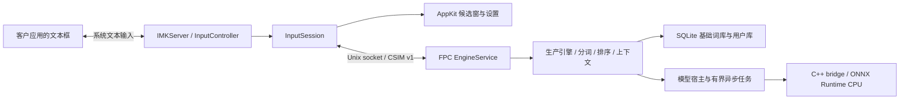

# macOS 实现架构

版本 2.1.0（build 5），对齐 Windows v2.4.0，使用原生 InputMethodKit / AppKit 前端和 Free Pascal 独立引擎。

## 模块和进程

`Cassotis.app/Contents/MacOS/Cassotis` 是 Objective-C++ 前端，`cassotis-engine` 是 Free Pascal helper。两个进程通过协议版本固定的 Unix socket 通信。基础词库、模型和运行库在 bundle 内；用户词库和设置在 Application Support，日志在 Library/Logs。

| 源码 | 职责 |
| --- | --- |
| `src/macos/main.mm` | 输入源服务器、IMK 控制器、生命周期与菜单 |
| `src/macos/InputSession.mm` | 系统事件、组合/提交、上下文、恢复与 helper 管理 |
| `src/macos/EngineClient.*` | 固定宽度二进制 codec、严格 UTF-8、请求和 generation 验证 |
| `src/macos/CandidatePanel.mm` | 非激活候选窗、补全行、分页、点击和用户词删除 |
| `src/macos/InputModePanel.mm` | 光标旁的中英文状态气泡、动画、自动收起及安全输入保护 |
| `src/macos/SettingsController.mm` | 行为设置、快捷键校验与原生显示偏好 |
| `src/macos/CustomPhraseEditor.*` | 有序短语编辑、显式添加与保存修改及 JSON 导入导出 |
| `src/service` / `src/ipc` | socket、连接上下文映射、dispatcher 和生产服务 |
| `src/engine` / `src/dictionary` | Windows/Linux 生产算法、生成模型、SQLite 和学习 |
| `src/host` | 本地模型宿主、队列、修正/补全和 C++ ONNX 桥接 |
| `tools/dictionary` | 移植后的 Windows 正式词库导入器 |

## 会话、文本和事件

每个活动 IMK 会话拥有一条连接。新控制器激活时先结束上一活动会话的组合，保证共享引擎在旧分段提交完成之后才切换上下文；失活时关闭连接。迟到的普通 keyUp 不会重新激活旧控制器。

组合区保存“已确认汉字＋剩余原始输入”。引擎供查询和重放使用的 composition 仍是剩余拼音，避免用已转换汉字再做拼音解析。Space 可以只确认一个分段；IMK 提交屏障循环确认剩余分段，并防止重复上屏。Escape 清除当前组合，Enter 沿用引擎原文提交语义。

普通 keyUp 不发给引擎。Shift 单键通过 flagsChanged 的按下/释放配对处理；参与 Command、Fn、其他修饰组合或鼠标操作时取消单键手势。Command、系统输入源快捷键、未配置的 Option 布局字符和死键透传。明确配置的 Option 快捷键使用不含 Option 变换的布局字符匹配。Mac 虚拟键转换覆盖方向、翻页、F1–F20 和数字键盘符号。

上下文限制为光标前最多 1,024 个 UTF-16 单元，避免从低代理项开始；读取不可用或发生异常时使用空上下文。初始标记区、提交与插入位置均使用 IMK 客户端协议。密码框由系统安全输入机制处理，不采集其文本。

候选窗通过 `attributesForCharacterIndex:0 lineHeightRectangle:` 查询组合串起点；该索引相对于当前 inline session，不能使用文档绝对 `selectedRange.location`。返回的行矩形采用 AppKit 全局屏幕坐标，允许零宽光标，按锚点所属屏幕的 `visibleFrame` 放置。下方空间不足时从整行上方留出 8 点间距，右侧空间不足时向左收进屏幕。默认一行候选加一行补全，按字体度量预留高度，补全内容变化不改变高度。启用多行选项后，翻页展开最多三行候选，补全行仍常驻。空矩形及非有限坐标不会覆盖原有备用位置。

候选视图保留原始 comment 给引擎校验和分段提交，显示时按 Windows 规则隐藏纯 ASCII 拼音后缀。默认单行候选，翻页可选展开最多三行，每行最多九项；活动行使用上游主题的浅底色与左侧细标记，选中词另铺底色；各行按自然宽度和剩余空间分配宽度，过长内容省略。小红 × 独立命中，视觉为 10 点、点击宽度为 22 点；末行常驻补全和品牌区。

状态气泡与候选窗共用光标查询，分别做屏幕边界布局。没有组合串时，IMK 的索引 0 表示当前选区位置。气泡为 64×40 点的非激活、鼠标穿透面板，使用候选配色，将 16 点彩色 logo 放在引擎确认的 13 点“中”或“英”左侧。激活时复用已有状态读取；只有配置的模式键额外读取切换后状态，普通输入不增加 RPC。光标尚未就绪时最多重试 0.4 秒；开始输入、出现组合串、切离或恢复连接均取消提示。Core Animation 实现淡入及轻微缩放，0.85 秒后淡出，开启减少动态效果时不缩放；定时器使用弱引用和代次检查，快速切换不会被旧定时器提前隐藏。安全输入、无效或屏外光标不显示气泡，也不退回鼠标位置。

状态气泡默认在光标上方，为通常位于下方的系统标识预留空间。系统光标附件常由当前应用的浮动窗口托管；使用 `CGWindowListCopyWindowInfo` 读取光标附近的小型浮动窗口边界、所属进程与层级，不读取窗口标题或图像，也不请求录屏或辅助功能权限。每 60 毫秒仅在气泡显示期间检查一次，避开稍晚出现、展开或翻到光标上方的标识；当前位置仍安全时保持不动，避免系统动画收起时来回跳动。找不到窗口元数据时保留默认上方布局；没有可容纳气泡且避开光标和附件的位置时收起提示。

设置使用原生 NSComboBox 数据源完成字体前缀定位与补全，确认时规范化字体名称，无效值回退。确认控件调用统一验证及持久化路径，失败恢复上次保存状态并内联显示原因；未完成的字体输入只更新预览，关闭不弹出保存对话框。

## IPC 与恢复

协议头是 44 字节小端 CSIM v1.0，字段包含类型、标志、request/context/generation 和 payload 长度。一个前端连接固定外部 context 1，服务端分配独立内部 ID。字符串最多 1 MiB、payload 最多 16 MiB，严格检查长度、UTF-8、保留字段、枚举和候选页范围。总帧上限容纳合法的最大短语列表，逐键读取不传输该列表。

state schema 6 保留 schema 5 的 40 字节布局，以 flags 的 0x10 位保存候选展开选项；schema 5 的禁用快捷键尾部保持不变，旧 schema 不接受新位；前端兼容读取 schema 4–9，服务保留更早的解码。用户库使用独立 disabled mask 持久化五个快捷键的禁用状态。

所有修改请求推进 generation；读取状态和轮询保留 generation。所有上下文请求（包括异步轮询）都经过连接的内外 ID 映射。异步结果只应用到同一 context/实例/generation，普通按键释放不会作废对应按下产生的补全任务。

候选点击和小红 × 验证视图仍属于当前内容；删除菜单携带候选视图版本，拒绝刷新前排队的旧操作。新前端使用消息 19 的快照校验动作；旧消息 18 `remove_candidate` 继续兼容 schema 1 的页内索引与 query / text / comment。服务核对当前身份和用户词属性，直接调用删除接口，不模拟 Ctrl+Delete，因此用户改键不会改变右键菜单的语义。异步补全是否可以挑战已有静态补全由核心判定，服务不再以“补全行非空”额外阻止请求。

同步请求设有 1,000 ms 故障上限，该值不是正常输入延迟目标。超时或异常会断开连接、保留并提交最后可见组合，将当前按键交给客户应用；不重放结果不确定的请求。管理器终止自己启动的故障 helper 并允许重启。管理模式 helper 带父 PID，在启动者退出后自动清理 socket 并退出。

helper 在输入源启动时提前启动。socket 尚未连接时，前端最多暂存 64 个普通拼音及相关编辑/选择按键，并立即显示临时组合串；25 ms 定时器在连接后按顺序回放，更新连续提交之间的上下文。捕获上下文早于临时组合串插入，避免把拼音当作左侧正文。两秒连接期限、焦点切换或不支持的按键触发原文恢复；清空队列早于客户端回调，防止重入时重复提交。已经发送而结果未知的请求仍不重放。Unix socket 位于系统私有临时目录，检查所有权和权限，使用锁文件防止双服务，Darwin 使用 SO_NOSIGPIPE。

## 算法、模型与资源

字符模型按输入音节和真实前文修正词典路径草稿，修正后仍通过读音、词频和路径保护；长句要求最低模型增益，短语则由共享评分和固定首选策略判断。不再加载独立的局部纠错、双向复核或风格模型。

长句补全以最终可见候选发起共享模型请求，旧生成器的预取管线已移除；工作结果只在 context、实例和 generation 相符时应用。显示和提交 Tab 时，仍验证不改变尾部锚点的前缀修正，不修改未输入的后缀。

紫光双拼分别转换声母与韵母；未完成全拼保留完整 ng 音节，并正确消费混合简拼的翘舌声母。共享用户词按当前简繁模式转换显示，同拼音的基础词库优先确定多义字形；学习仍更新原有记录，删除同时处理简繁别名。

异常拼音范围随结果载荷传递，范围为 UTF-16；schema 4 同时包含补全来源及已发布的候选快照，保留读取 schema 1/2/3 的兼容能力。原生前端给对应标记文本添加红色文字与下划线颜色；IMK 或应用可能重建并替换这些属性，因此候选窗底部的补全行同时用红色和下划线显示异常拼音片段。仅错误时显示，修正后清除，不改变输入文本、选区、当前布局的行高、Tab 补全和品牌区。长输入截取首个错误附近的片段，完整拼音保留在提示文本中。正常音节、未完成声母和双拼编码按各自方案判断；重复元音只在有足够输入证据时提示。

核心对齐 Windows 2.4.0，保留 Linux 的 FPC 适配与 macOS 的组合串语义。预测前缀准入由 `nc_prefix_completion_policy` 管理，候选快照和导航稳定性由 `nc_candidate_presentation` 管理；鼻音边界、已确认后缀、短复合词上下文证据、ü 别名和冷启动分页均有独立回归。共享轻量排序的两个局部缓存标志在入口显式初始化。

运行时只有一个约 1.5 亿参数的字符语言模型，与 Windows 2.4.0 的部署资产一致；长句、短词、补全、短语生成及拼音修正共享同一 ONNX session。ORT 1.20.1 固定 CPU 执行，使用静态 int8 激活范围、float16 embedding 和自定义 TrieAttention。Apple Silicon 使用保留八通道规约顺序的 NEON 内核；修正按真实前文最后 48 个字符和输入音节约束，短语 beam 为 2。长句 Tab 保留 80 ms 结果预算，迟到结果不交付；字符评分支持真实取消。前台和后台仍通过有界锁等待及上下文校验隔离。

`nc_runtime_paths` 统一解析 bundle 内的运行资源路径，各模型宿主在实际加载文件时使用该解析器。输入法前端以 `cassotis-engine --serve` 启动服务，传入基础词库、用户词库、socket 和父进程参数；`--version` 用于读取引擎版本。

基础数据库只读，用户数据库使用独立可写路径。Lexicon 2.4.0 的 26 个输入通过 schema 24 导入器重建简繁两库，完整保留 query paths、转移、补全竞争/审计和正反字符语言模型，并要求带候选指纹的短词提升表；模型与 schema 的 SHA-256 在 `data/runtime-assets.sha256`，词库生成输入校验值在 `data/lexicon-inputs.json`。

平台时钟统一为 mach_absolute_time，避免 FPC 默认 Darwin 计时发生系统时钟回退；性能频率由 mach_timebase_info 获取。

## 构建和安装

`scripts/build.sh` 检查编译环境与资产，依次构建 C++、FPC、词库和应用，并由内向外签名。调试符号保存在构建目录，不把 dSYM 放入应用可执行文件目录。安装器先验证暂存副本，再结束输入、备份和替换已安装 bundle，失败可回退。

评分方法、测量范围与汇总结果见 [BENCHMARK.md](../BENCHMARK.md)。

## 精确拼接与前缀保护

首屏全拼没有预测时，`nc_tab_exact_fallback` 可把已输入的两个精确词段拼接为 Tab 结果。头尾都必须是完整词并逐字符合当前音节，明确分隔符不能被重切，重复完整候选不展示；翻页和编辑会失效缓存。确认该结果不新增用户词或补全学习反馈。预测整段使用主题强调色，精确拼接整段使用普通文字色。

结果 schema 3 保留 schema 2 的警告列表，追加补全来源 byte、零保留 byte 和零保留 uint16。来源 1–6 为预测，7 为精确拼接，8 为自定义短语；非空补全才能携带来源。新前端读取 schema 1/2 时把旧非空补全视为预测；清空上下文同时清除来源。升级时前端和引擎一起替换。

缓存词链复用需要按当前音节逐段验证，五音节也进入精确词链搜索；新快速分支保留有转移证据的四字复合前缀。字符 LM 冷缓存仅补载最多 64 段、每段 40 个 UTF-16 单位；前缀学习使用精确键的有界重复选择证据，先复制缓存候选再排序。

## 共享排序与候选快照

共享字符级自回归模型统一判断长句、上下文短词、混合简拼和 Tab。三到五音节但不在词库中的短语，先产生有限精确词段草稿，再由模型判断并按读音修正；不再无条件拼接“我/你/就/不/很＋词”。固定首选只作用于完整精确查询，用户已选词与输入读音继续受保护。自动生成的首选不直接写入用户词库，显式选择的其他短语可以学习。六音节及以上逐键输入与整串输入回到同一候选构建路径；专业词层仍只参与精确输入。

每个会话维护候选 viewport。编辑时收起，开启选项后翻页/上下键展开，最多显示连续三页；活动行保留数字快捷键，其他行可直接点击。最终可见池保持候选和来源索引一致，递减长句前缀按自身拼音长度选入，保留剩余输入。Tab 页保持常驻；展开时保持水平位置，屏幕边缘继续避开光标。

结果 schema 4 在 schema 3 后追加 uint64 快照版本、最多三行的 page/index/candidate 列表，每行最多九项。解码校验连续页、活动行与主候选一致、候选类型和全部边界。消息 19 携带快照版本、页、页内索引、删除标志及 query/text/comment；服务核对最近发布的快照与当前最终池后原子选择或删除，拒绝迟到点击。消息 18 继续支持原有校验删除。前端与引擎随 bundle 一起升级。

## v2.0.0 共享字符模型与 Tab

`nc_char_lm_host` 按清单验证模型与词表，后台加载并共享一个会话；前台调用有界等待，后台视图让前台评分优先。原生 ABI 使用 UTF-16 文本、UTF-8 路径与错误，避免 Darwin 的 32 位 `wchar_t` 差异。前缀树打包控制节点工作量，ONNX RunOptions 支持真实超时取消，取消后会话可继续使用。

短词 Tab 先显示词库选择，`nc_one_key_rerank_host` 仅保留最新待处理任务。IPC 轮询依据上下文实例、代数和当前请求交付，失败或未改变选择也会结束等待。长句补全直接根据最终可见候选执行共享模型策略，比较当前词补全、后续短语及下一个字；原续写生成器、索引和预取通道均已删除。候选每个汉字按输入音节重新验证，显式隔音符边界不允许跨越。

共享字符模型在 Git 和源码归档中保存为四个编号分片（`.000`–`.003`）。`char_lm_model_parts.py` 验证连续编号、总文件摘要并原子替换；失败不留下半成品。App 仅安装合并 ONNX、词表、拼音读音表和运行清单，不安装分片。只有一个神经图和七组小型树参数；旧神经模型、索引、宿主和不再适用的归属文件不再分发。

## 快捷输入与数字小数点

`nc_quick_input` 生成 U/I/V 符号、日期、时间、中文数字及金额候选，不调用语言模型、不记录用户词。快捷候选的来源为 `cs_quick_input`；数字转换使用 a/b/c/d 选择键，数字继续编辑。双拼用 Shift+U/I/V 显式进入；失效命令恢复双拼，退格回到合法编码后重新进入快捷模式。会话恢复保留大写输入的 Shift 语义。

Key schema 2 携带一次性直接输入数字提示；State schema 7 保存默认开启的自动小数点选项，旧设置自动使用默认值；Result schema 5 保存当前候选选择键。前端只记住刚刚由该会话直接输入的数字，结合光标位置、选区、全局按键/鼠标及修饰键计数拒绝过期提示，不使用 HID 或输入监控权限，也不把粘贴内容当作直接输入。设置即时保存。

候选点击使用已发布的快照。异步 Tab 更新若不改变候选文字、来源、可删除性及行布局，继续接受原快照；输入、候选或页变化使其失效。服务仍验证上下文、代数、查询和候选身份，不模拟数字按键进行点击选择。

## 英文识别与半角标点

State schema 8 在原 40 字节状态后追加英文识别 Boolean、三个零保留字节及 UTF-8 半角标点列表。读取旧协议或缺失的用户库设置时使用默认开启的英文识别与 Markdown 预设；显式关闭和空列表在升级、重启和其他设置修改后保留。设置字段、协议两端、引擎和 SQLite 持久化保持一致。

Result schema 6 追加英文原文与选中状态，长度为 2–32 个 ASCII 字母，不属于中文候选数组。候选 UI 首页在中文 1–9 之前渲染无编号英文项；中文数字键语义不变。消息 19 的页 0、索引 -1 表示英文选择，只接受非删除动作、非空期望文本和空 comment，并核对上下文、快照版本、query 和实际原文。旧快照不能上屏。原生视图 tag -2 对应英文，tag -1 继续表示 Tab 补全。

英文判断使用本地拼写证据与同一共享字符模型，不新增神经模型。用户对英文/中文的选择存入既有最近选择表，英文不形成用户词或中文词频。标点例外只在中文半角输入并使用中文标点时生效；全角、快捷输入、翻页及快捷键仍优先。前端和 helper 随同一应用一起升级。

## v2.1.0 的繁体与短语评分

`nc_char_lm_traditional` 为繁体引擎包装同一个共享模型：所有评分文本、上下文和指定下一字查询转为简体，生成的字按台湾惯用字形返回。会有歧义且繁体仍使用其原形的字不任意改写；连续生成在歧义处结束。纠错包装器按位置保留未改动字的原繁体形式。内部规则中的简体常量使用与词库变体对应的字形，翻页及提交前统一转换并去重。整句拼音纠错及词库外短语生成仍按上游限制用于简体输入。

短语评分通过 `IncCharLmQuery` / `nc_lm_score_next_query` 在一次模型前向中取得完整短语和被查询后继字的概率，过滤薄弱单字拼接及近似重复短语。对草稿池之外的所有纠错文本重新评分；次选距离首选不超过 1 nat，防止仅靠逗号加分的次选进入列表。规范音节及前缀使用缓存集合，候选读音使用字典缓存；尚未键入的后续音节只在补全区出现。

后台短词和长句补全任务携带排队时的词库变体，由工作线程为该任务建立只读繁体包装器。切换简繁不会替换共享模型对象，代数与请求检查仍拒绝过期结果。前台优先调度、推理预算和 UTF-16 原生接口保持不变。

## 调试上文快照

状态 flags 的既有 0x08 位控制调试模式；“高级”页提供独立于运行日志的自动保存开关。服务在生成候选时记录上文及来源，只有开启调试时才用 Result schema 7 追加启用位、来源、文档是否提供上文、零保留字节和文本。关闭后使用普通 schema 6，不发送该文本。前端兼容旧结果，并校验新标志、枚举和截断。

Surrounding schema 1 表示应用提供了上下文，即使内容为空；schema 2 追加可用性标志，使读取失败与真实空文档可区分。读取失败发送空文本和零光标位置，不保留其他客户端的上文。客户端上下文独立保存该标志，候选快照不从 UI 线程反向读取引擎。

右下角在调试时替换 logo 与版本为来源标签及上文，标签为文档、上屏、已选、上文为空或未读到上文。控制字符替为空格、单行从头省略、尾部右对齐；仍保留 Tab 和拼音诊断的空间，不以长上文扩大窗口。正常模式和设置预览保留原有品牌显示。

## 自定义短语

自定义短语由共享引擎按原始字母缩写匹配，使用独立的补全来源且不会被异步预测覆盖。完整有序列表随设置 schema 9 传输，最多 1024 条，每条正文最多 4096 个 UTF-16 单元。空的 GET_STATE 请求读取完整状态；附带 Boolean false 时返回不含短语列表的 schema 8。写入 schema 8 及更早格式时，服务保留已有短语，避免旧客户端或普通模式切换清空配置。

引擎保留不可变配置快照和缩写索引，重复键按列表中第一条生效。字面提交复用不学习的快捷文本路径，保留空格、换行和标点；候选窗仅截短预览，完整正文仍用于提交。列表作为 JSON 在用户 SQLite 配置中按事务保存，清除学习不会删除。AppKit 编辑器将草稿与已保存列表分开，点击“添加短语”或“保存修改”后才写入；取消、失焦或关闭窗口不提交草稿。导入整份校验后追加，日志合并到高级页。词库与 Lexicon v2.4.0 对齐，输入由随源码分发的校验清单固定。

## 输入频次导入

“高级 → 导入输入频次…”先显示格式和影响说明，用户继续后再打开文件选择器。独立后台连接使用消息 20，schema 1 请求携带绝对 UTF-8 文件路径，响应为解析条目数与实际导入条目数；普通按键时限不变，导入连接使用 10 秒时限。UI 禁止重复导入及同时清除，只有事务成功提交才显示成功。

文件最多 32 MiB，识别 UTF-8、带 BOM 的 UTF-16 和 GBK，按上游规则解析逗号／Tab 分隔及带序号的统计格式。词语仍经过完整拼音、读音和学习规则验证；按频次从低到高记忆，每项最多累计 400 次，基础词不重复写入用户词表。写事务失败回滚；导入完成后作废各上下文的候选快照和后台任务身份，保留输入串与文档上文，重建候选。清除学习记录同时删除短词和长句补全反馈。
